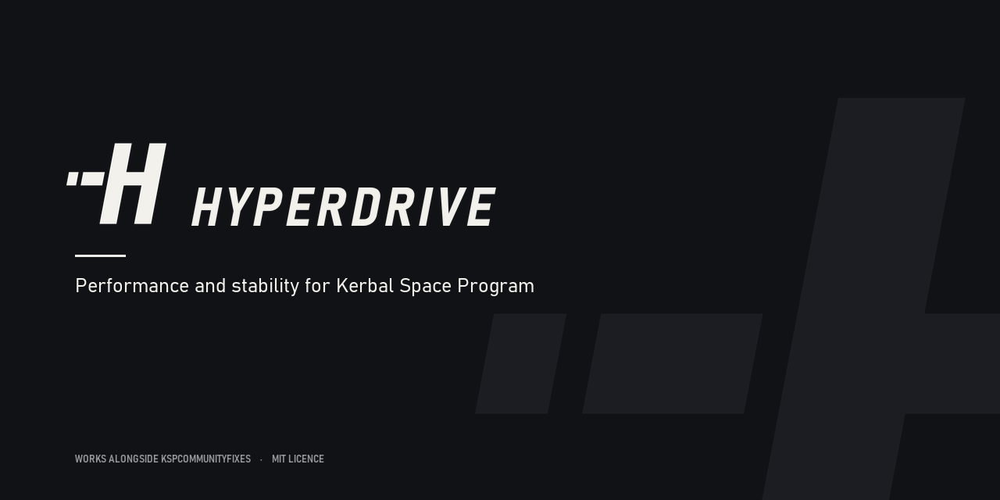
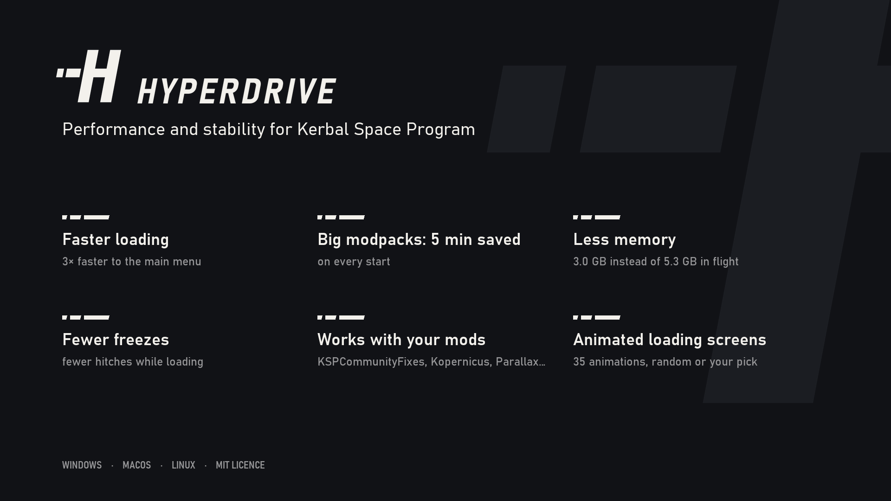
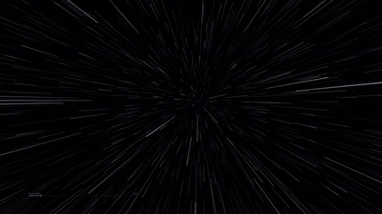
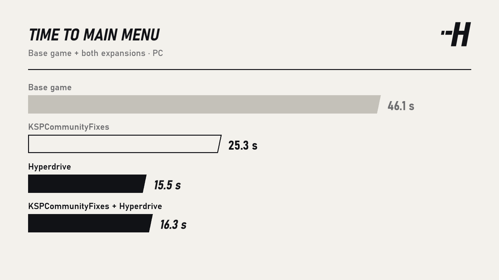
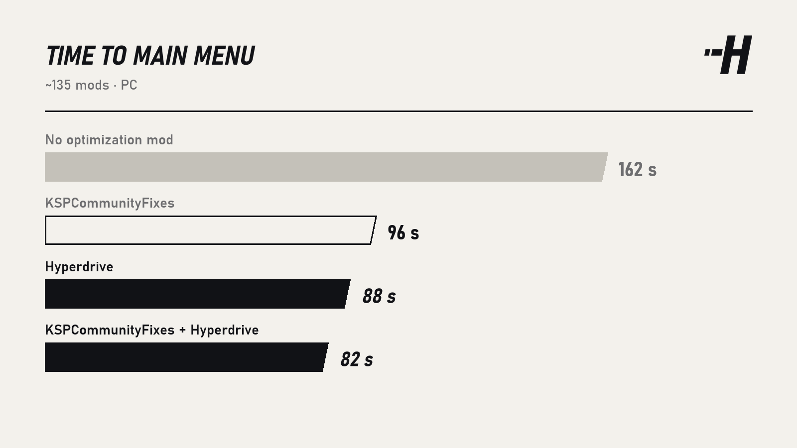
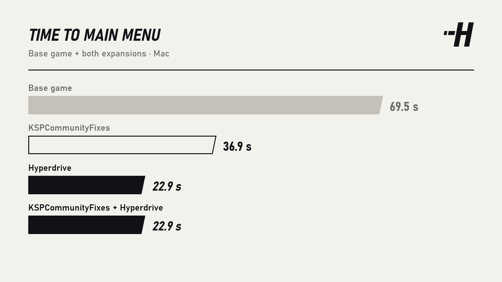
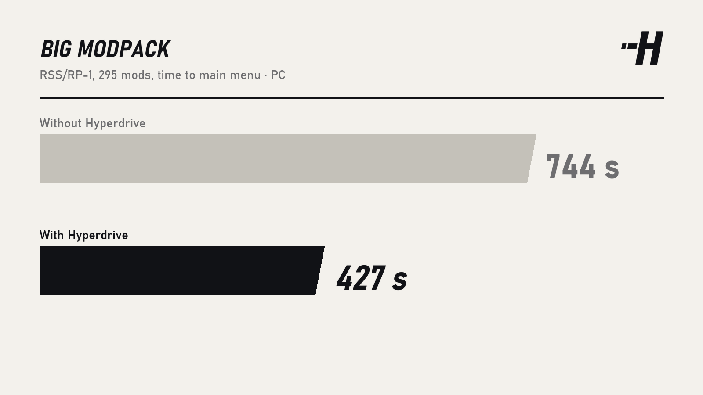
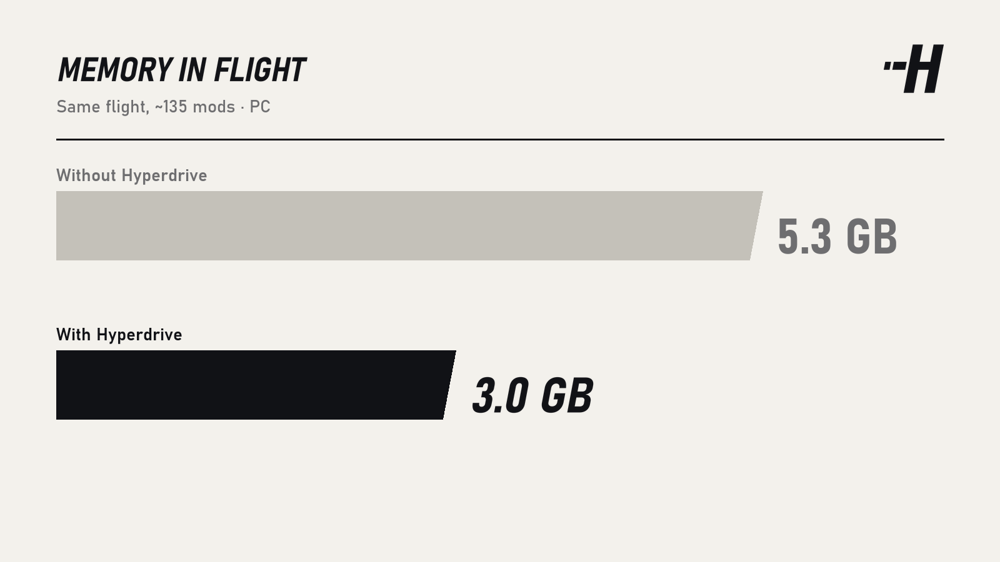

# Hyperdrive

Hyperdrive makes Kerbal Space Program load faster, use less memory, and fixes several of the game's leaks and hangs. It
works on its own or with KSPCommunityFixes, and every feature can be switched off in the settings.





## Install
1. Install [HarmonyKSP](https://github.com/KSPModdingLibs/HarmonyKSP).
2. Copy `GameData/Hyperdrive` into the game's `GameData` folder.
3. Recommended: [KSPCommunityFixes](https://github.com/KSPModdingLibs/KSPCommunityFixes); the two work together.

Windows and macOS tested. Linux is supported but not yet tested on a real machine: reports welcome.

## What it changes
- **Faster loading**: the main menu in 15.5 s instead of 46 s on the base game with both expansions, 88 s instead of
  162 s with ~135 mods.
- **Big modpacks**: when a single ModuleManager patch has an error, ModuleManager redoes all its patches at every start.
  Hyperdrive keeps its cache: 427 s instead of 744 s on a 295-mod RSS/RP-1 modpack.
- **Less memory**: 3.0 GB instead of 5.3 GB in flight.
- **Fewer hangs**: loads that used to get stuck (antivirus, Windows file locks, launch pad terrain with Parallax) go
  through, and several stock leaks are fixed.
- **Animated loading screens**: 35 animations, random or your pick.

With KSPCommunityFixes, Hyperdrive leaves to KSPCF what it already does and adds the rest: 16 s instead of 25 s to the
menu on the base game, 82 s instead of 96 s with ~135 mods.

## Measurements
Measured on a PC (i5-14600KF, 32 GB, Windows 11) and a MacBook Air M4. Details in `docs/BENCHMARKS.md`.







## Settings
In game: pause menu → Settings → Hyperdrive, the Hyperdrive toolbar button, or Alt+F10. Advanced settings are explained
in `GameData/Hyperdrive/Hyperdrive.cfg`.

## Compatibility
When another mod changes the same part of the game, Hyperdrive leaves it the job. It works with Kopernicus, Parallax,
FAR, ModularFlightIntegrator and Principia, and was tested on a 295-mod RSS/RP-1 modpack.

## Problems?
Open an issue with `KSP.log` (in the game folder) and `Player.log`.

---
<sub>Hyperdrive by Warnix. MIT licence (see `LICENSE`). Thanks to the KSP community, and to KSPCommunityFixes for
several ideas.</sub>

## Building
```bash
cp KSP.props.user.example KSP.props.user   # then set the KSP path in it
dotnet build Hyperdrive.sln -c Release      # builds and copies the mod into KSP
zsh tools/package.sh                        # player archive in dist/ (Windows: tools\package.ps1)
```
See `docs/ARCHITECTURE.md`, `docs/API.md`, `docs/BENCHMARKS.md`, `docs/DEVELOPER_SETTINGS.md`.
